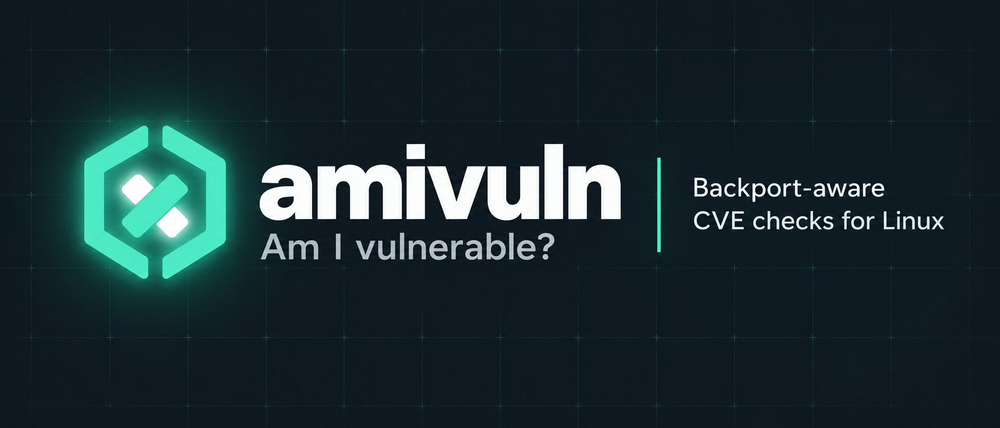

<p align="center">
  
</p>

# amivuln


> Am I vulnerable? Backport-aware CVE checks for the binaries, services and packages on *this* host.

**Status:** pre-alpha. Nothing is usable yet.

<br clear="left">

## Why

Generic scanners compare upstream versions and report CVEs that your distribution has already patched via backports. amivuln asks the distribution's own security data first, so a package fixed by your distro is not reported as vulnerable.

## Install

No release is published yet. Each release will provide:

- Static `musl` binaries (`x86_64`, `aarch64`) that run on any Linux distribution.
- `gnu` binaries (`x86_64`, `aarch64`) linked against glibc 2.34 or newer (Debian 12, Ubuntu 22.04, Fedora 35, RHEL 9 and later).
- `.deb`, `.rpm`, `.apk` and Arch (`.pkg.tar.zst`) packages wrapping the static binary.
- `SHA256SUMS` signed with cosign (keyless), GitHub build provenance attestations, and a CycloneDX SBOM.

Verify a download before running it:

```bash
gh attestation verify amivuln-x86_64-unknown-linux-musl.tar.zst --repo nubian-ibex/amivuln
cosign verify-blob SHA256SUMS --bundle SHA256SUMS.sigstore.json \
  --certificate-identity-regexp '^https://github.com/nubian-ibex/amivuln/\.github/workflows/release\.yml@refs/tags/v' \
  --certificate-oidc-issuer https://token.actions.githubusercontent.com
sha256sum -c SHA256SUMS --ignore-missing
```

The `.rpm` and `.deb` packages are not signed with a package-manager key yet. Install the `.rpm` with `rpm -i --nosignature` only after the checks above.

## Usage

```bash
amivuln nginx                          # an installed package
amivuln /usr/sbin/nginx                # the package that owns a file
amivuln openssl@3.5.1-1 --distro arch  # a version, without reading the host
amivuln --all --fail-on high           # every installed package; exit 1 on HIGH or worse
amivuln --all -f json > report.json    # machine-readable, schema version 1
```

Formats: `summary` (default), `detail` and `json`. Exit codes: 0 clean, 1 findings at or above `--fail-on`, 2 incomplete (a required source was unavailable), 3 target not resolved, 64 usage error, 70 internal error. See `man amivuln` and `amivuln --help`.

In a CI pipeline, `amivuln --all --fail-on high` fails the job when an installed package has a pending high-severity security fix, and exit code 2 keeps an outage of the advisory data from passing as a clean scan. To check a package version for a distribution other than the runner's, use `name@version --distro fedora:44` or `--distro arch`.

Configuration is optional: `amivuln config init` writes a commented file to `~/.config/amivuln/config.toml`. Search order, first file found wins: `./.amivuln.toml`, `$XDG_CONFIG_HOME/amivuln/config.toml`, `/etc/amivuln/config.toml`. Flags and `AMIVULN_*` variables override the file.

## How it works

Target, then resolver, then package identity, then advisory query, then distro-aware matching, then enrichment (KEV, EPSS), then policy and report. Only ecosystem, package name and version ever leave the host. No telemetry.

## Limitations

- Fedora and Arch Linux only for now. Debian, Ubuntu, Alpine and RHEL come later.
- On Fedora the data is the repository `updateinfo`: amivuln reports security fixes that Fedora has published and that are newer than what is installed. A vulnerability with no published Fedora fix is not visible there.
- Security updates that name no CVE are reported under their update id (for example `FEDORA-2026-...`).
- Targets are packages, files owned by a package, versions and purls. systemd units, PIDs, SBOMs and binaries that no package owns (vendored libraries, language dependencies) are not supported yet; use a lockfile scanner such as osv-scanner for those.
- Kernel CVEs and container image scanning are out of scope until after 1.0.

## Comparison

Trivy and Grype scan images and filesystems; osv-scanner scans lockfiles; arch-audit and debsecan cover one distro each. amivuln starts from a single installed target and applies distro patch status.

## Security

See [SECURITY.md](SECURITY.md).

## Contributing

See [CONTRIBUTING.md](CONTRIBUTING.md).

## License

Licensed under either of [Apache License, Version 2.0](LICENSE-APACHE) or [MIT license](LICENSE-MIT) at your option.
