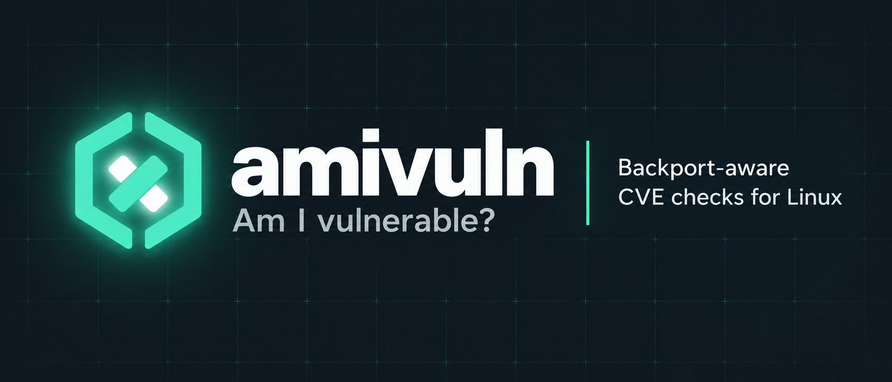

# amivuln



**amivuln** answers one question: *which CVEs apply to this package, file or
version on this host, taking the patches my distribution already shipped into
account?*

Generic scanners compare upstream version ranges and report CVEs that your
distribution fixed long ago through backports. amivuln asks the distribution's
own security data first, so a package your distro has fixed is not reported as
vulnerable, and a security update you have not installed yet is.

```console
$ amivuln pcre2 --format detail
pcre2 10.47-1.fc44.1 (Fedora 44)
  CRITICAL 0   HIGH 8   MEDIUM 0   LOW 0   KEV 0   EPSS max 0.00
  Fixed in: 10.49-1.fc44  (dnf upgrade pcre2)
  Affected:
    CVE-2026-103111  HIGH   fix: 10.49-1.fc44  EPSS 0.00
    ...

source fedora-updateinfo  ok  age 0s  required
source kev                ok  age 0s
source epss               ok  age 0s
result: complete
```

## Principles

- **Precision before coverage.** A false positive from a backport is a bug.
- **Never degrade silently.** Every result lists the status of each source. A
  required source that failed makes the result *incomplete* (exit code 2), so
  an outage can never look like a clean scan.
- **Nothing identifying leaves the host.** Only the ecosystem, package name and
  version are sent. No telemetry.
- **The output is a contract.** JSON with a versioned
  [schema](json-schema.md).
- **Verifiable releases.** Checksums, GitHub build attestations, a cosign
  signature and an SBOM accompany every release.

## Status

Pre-alpha. Fedora and Arch Linux are supported, as are Rocky Linux and
AlmaLinux 8 and 9 through OSV (`--distro rocky:9`, `--distro alma:9`). Alpine
and Red Hat Enterprise Linux come later (OSV has no RHEL data). See [Data sources](sources.md) for exactly what each
distribution report covers and where the blind spots are.

Start with [Installation](installation.md) and the [Quick start](quickstart.md).
